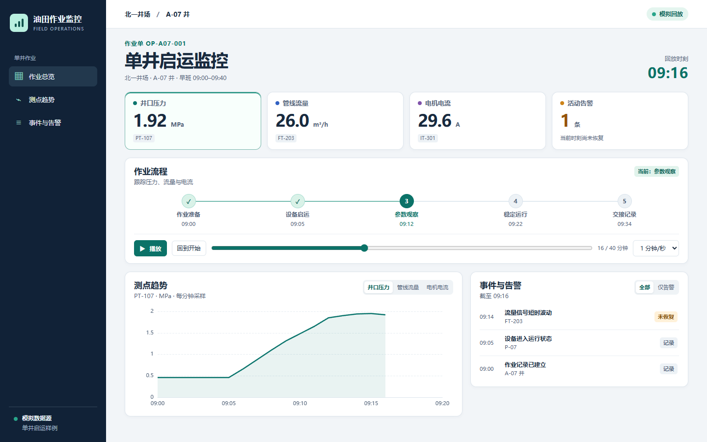

# 油田作业监控

面向单井作业过程的监控原型。首页展示示例井 A-07 从作业准备到交接记录的 40 分钟过程，工序、测点和告警共用同一条回放时间轴。



## 演示内容

- **作业流程**。播放、暂停、变速，或点击工序跳到它的开始时间。
- **测点趋势**。查看井口压力、管线流量和电机电流。切换测点卡片即可查看对应曲线。
- **告警与缺采**。页面按回放时间显示已发生的事件。拖到 09:16 可查看流量波动告警，拖到 09:28 可查看压力测点中断。缺采读数显示为「无采样」，趋势曲线保留断点。

样本由代码生成，用于验证界面和回放逻辑。现场接入需另外配置测点、数据源和告警规则。

## 本地运行

使用 Node.js 22.12 或更高版本，本项目已用 Node.js 24 验证。

```sh
cd frontend
npm ci
npm run dev
```

在 `frontend` 目录运行 `npm run build` 后，可直接用浏览器打开生成的 `dist/index.html`。运行 `npm run verify` 会执行类型检查、构建和离线浏览器验收。浏览器脚本默认查找 Edge 或 Chromium，也可用 `BROWSER_PATH` 指定浏览器路径。

## 目录

| 路径 | 用途 |
| --- | --- |
| `frontend/src/monitor/` | 主作业监控应用及其模拟回放数据，Vue、TypeScript、ECharts |
| `frontend/tools/verify-monitor.mjs` | 离线加载、回放、告警和窄屏布局验收 |
| `frontend/screen/`、`frontend/twin/` | 两个独立的大屏和三维展示原型；各自需要本地 `src/data.json` |
| `pipeline/` | 措施事件提取、递减基线、预测与区间、组合优化、回测和孪生状态脚本 |
| `tools/` | 数据打包、离线验收与 Blender 模型生成工具 |

此前的决策沙盘和三维大屏源码作为历史版本保留。两个独立大屏的 `data.json` 和模型流水线的原始样本存放在原交付目录。早期决策沙盘的说明见 `frontend/README.md`。
